> 一个写了 13 年 Java 的后端架构师，聊聊我怎么用 AI 工具干活的。
>
> 每个工具我都真的用过，每个坑我都真的踩过。不是科普，是实战记录。
> 
> 

---

- [我用 AI 做了什么](#我用-ai-做了什么)
- [概览：AI IDE、Vibe Coding 与 Agent](#概览ai-idevibe-coding-与-agent)
  - [AI IDE：代码编辑器的第三次进化](#ai-ide代码编辑器的第三次进化)
  - [Vibe Coding：一种新的编程方式](#vibe-coding一种新的编程方式)
  - [Agent：大模型的"手和脚"](#agent大模型的手和脚)
  - [三者的关系](#三者的关系)
- [AI IDE 对比](#ai-ide-对比)
  - [五款 IDE 对比](#五款-ide-对比)
  - [选型建议](#选型建议)
  - [我的日常组合](#我的日常组合)
- [Vibe Coding 体验](#vibe-coding-体验)
  - [起源](#起源)
  - [我的演进](#我的演进)
  - [适用场景决策树](#适用场景决策树)
  - [Prompt 技巧](#prompt-技巧)
  - [风险](#风险)
- [Hermes Agent 深度解析](#hermes-agent-深度解析)
  - [为什么选 Hermes Agent](#为什么选-hermes-agent)
  - [核心原理](#核心原理)
  - [插件与工具生态](#插件与工具生态)
  - [我的实战案例](#我的实战案例)
    - [案例 1：内容生产管线](#案例-1内容生产管线)
    - [案例 2：个人知识库（Wiki）](#案例-2个人知识库wiki)
  - [使用心得](#使用心得)
  - [周边工具链](#周边工具链)
    - [Skills Manager（技能管理）](#skills-manager技能管理)
    - [CC Switch（模型切换）](#cc-switch模型切换)
    - [cc-connect（远程桥接）](#cc-connect远程桥接)
    - [其他周边工具](#其他周边工具)

---

# 我用 AI 做了什么

过去一年，我把 AI 工具从"偶尔玩玩"变成了"每天必用"。以下是我实际跑通的几个场景：

| 项目 | 技术 | 说明 |
|------|------|------|
| **热点内容生产** | Hermes Agent + Cron | 每日热点采集→提炼→去 AI 味→平台分发→Wiki+钉钉归档 |
| **个人知识库** | Hermes Agent + LLMWiki | 结构化知识库，实体/概念/对比三类页面，wikilinks 交叉引用 |
| **自动化助手** | Playwright + AppleScript | 自动搜索记录，沉淀防封策略 |
| **跨境电商 ERP** | Spring Boot 3.5 + Java 21 | OpenSpec 需求分析 + Claude Code 编码协作 |
| **macOS 自动化** | AppleScript + CLI | Chrome 控制、备忘录、iMessage、FindMy |

---

# 概览：AI IDE、Vibe Coding 与 Agent

## AI IDE：代码编辑器的第三次进化

2021 年 Copilot 问世，2023 年 Cursor 出来，代码编辑器开始不一样了。以前是纯文本工具，现在能理解你的项目、帮你写代码、甚至帮你重构。这是大模型能力最早落地的场景。

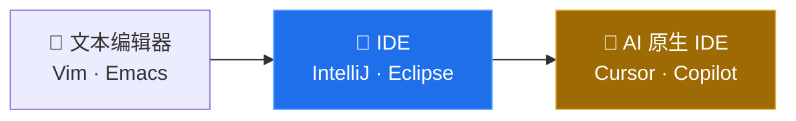

| IDE | 核心优势 | 价格 | 我的用法 |
|-----|----------|------|----------|
| **Cursor** | Agent 模式最强 | $20-200/月 | 快速原型 |
| **VS Code + Copilot** | 生态最大，最便宜 | $0-39/月 | 日常开发 |
| **JetBrains AI** | Java 生态最强 | 捆绑订阅 | Java 项目 |
| **Qoder** | Spec 驱动开发，需求→设计→代码 | 按量付费 | 需求分析 + 架构设计 |
| **OpenCode** | 开源终端 Agent，轻量灵活 | 免费(BYOK) | 终端编码、PR Review |

## Vibe Coding：一种新的编程方式

2025 年 Karpathy 发了条推文，说有一种新的编程方式叫 vibe coding，"忘掉代码本身，拥抱感觉"。说白了就是用自然语言告诉 AI 你想要什么，它来写代码。这其实是 AI IDE 的下一步：不只是辅助你写代码，而是让写代码这件事本身变得可选。

听起来挺好，但我自己的感受是：写个脚本、做个原型，确实快。但放到生产级后端上，我还是不放心。我的做法是用它加速，但最终靠自己的经验把关。

## Agent：大模型的"手和脚"

Vibe Coding 是让 AI 帮你写代码，Agent 是让 AI 帮你干活。2025 年开始，Agent 从编程场景扩展到了通用任务：规划任务、调用工具、操作浏览器、管理文件，自己把一整套流程跑完。

```mermaid
graph TB
    subgraph Agent["🤖 AI Agent"]
        LLM["🧠 大脑 LLM"]
        MEM["💾 记忆系统"]
        PLAN["📋 规划引擎"]
        LLM <--> MEM
        LLM <--> PLAN
    end
    subgraph Tools["🔧 工具集"]
        T1["📁 文件"] --- T2["💻 终端"] --- T3["🌐 浏览器"] --- T4["🔌 API"]
    end
    subgraph Exec["⚡ 执行"]
        E1["本地终端"] --- E2["云端沙箱"] --- E3["浏览器"]
    end
    LLM --> Tools --> Exec -->|"观察结果"| LLM
    style Agent fill:#161b22,stroke:#30363d
    style Tools fill:#161b22,stroke:#30363d
    style Exec fill:#161b22,stroke:#30363d
```

这里面有几个绕不开的概念。ReAct 模式是所有 Agent 的基础，就是"想一想、做一做、看看结果、再想一想"这个循环。MCP 协议解决了工具连接的标准化问题，类似于 USB 之于硬件。上下文工程决定了 Agent 能看到什么信息，这一条往往比选哪个模型更影响效果。

## 三者的关系

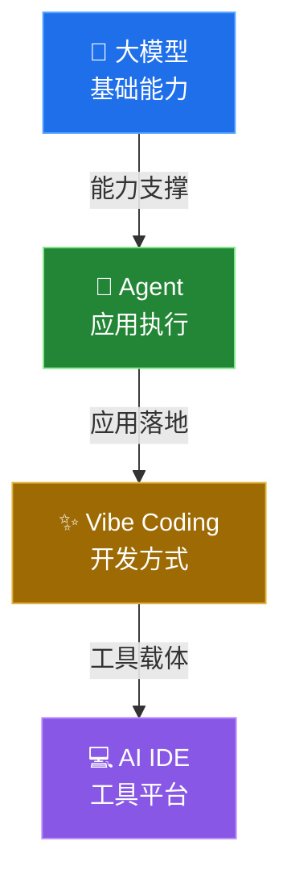

打个比方：大模型是引擎，Agent 是汽车，Vibe Coding 是驾驶方式，AI IDE 是驾驶舱。

---

# AI IDE 对比

## 五款 IDE 对比

| IDE | 基础 | 核心优势 | 主要缺点 | 价格 |
|-----|------|----------|----------|------|
| **Cursor** | VS Code Fork | Agent 模式最强，代码库索引出色 | 信用额度制费用高 | $20-200/月 |
| **VS Code + Copilot** | VS Code 原生 | 生态最大，价格最低，最稳定 | AI 集成深度不如 Cursor | $0-39/月 |
| **JetBrains** | IntelliJ 平台 | Java 生态最强，重构能力第一 | AI 起步较晚，资源占用大 | 捆绑订阅 |
| **Qoder** | 终端/IDE | Spec 驱动开发，需求→设计→代码全流程 | 生态较新，社区小 | 按量付费 |
| **OpenCode** | 终端(TUI) | 开源轻量，多 Provider 支持，PR Review | 功能不如 Cursor 丰富 | 免费(BYOK) |

## 选型建议

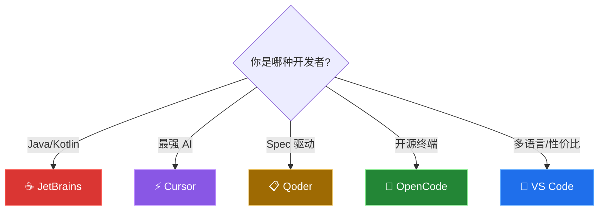

## 我的日常组合

| 场景 | 工具 | 原因 |
|------|------|------|
| Java 项目 | IntelliJ + Cursor/Qoder/OpenCode | Java 生态最强 |
| 快速原型 | Cursor + Claude | Agent 最强 |
| 终端自动化 | Hermes Agent | 多平台网关 |

---

# Vibe Coding 体验

> 从手写每一行到"说人话写代码"，一个 13 年老兵的真实感受

## 起源

2025 年 Karpathy：

> *"There's a new kind of coding I call 'vibe coding', where you fully give in to the vibes, embrace exponentials, and forget that the code even exists."*

## 我的演进

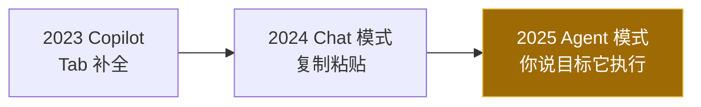

从 Copilot 的 Tab 补全（说实话对我这种老手帮助有限），到 Chat 模式（每次都要复制粘贴，上下文断裂），再到 Agent 模式（你说目标它自己去改文件、跑测试）。每一步都是质的飞跃。

## 适用场景决策树

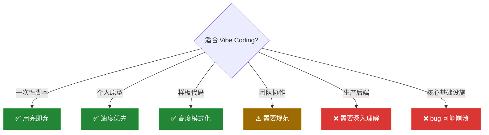

## Prompt 技巧

Vibe Coding 的效果，80% 取决于你的 Prompt 质量：

| 技巧 | 说明 |
|------|------|
| 说清楚技术栈 | 不要让 AI 自己选，它可能选一个你不熟的 |
| 描述行为而非实现 | "用户登录后跳转首页" 比 "用 redirect" 好 |
| 给出约束条件 | "不要用 class 组件"、"用 Java 21 record" |
| 分步骤描述 | 复杂需求拆成小步骤，每步给 Agent 执行 |
| 提供上下文 | "参考 UserService 的写法" 比从零开始好 |

## 风险

几个实际风险。技术债：你不理解代码就没法优化和重构，跑得快但债务在涨。安全漏洞：AI 会生成有 SQL 注入、XSS 问题的代码，它不替你把安全关。调试困难：出了 bug 你不懂逻辑，排查起来很痛苦。能力退化：长期依赖 AI，手写代码的感觉会变钝。

---

# Hermes Agent 深度解析

Claude Code、Cursor Agent 我都用过，最后选了 Hermes Agent 当主力。不是因为它某一项最强，而是它的组合方式最对我的路子。

## 为什么选 Hermes Agent

| 特性 | Hermes Agent | Claude Code | Codex CLI |
|------|:---:|:---:|:---:|
| 开源 | ✅ | ❌ | ✅ |
| 多平台网关 | ✅ (Telegram/Discord/Slack/钉钉...) | ❌ | ❌ |
| 技能系统 | ✅ (可复用 procedure) | ❌ | ❌ |
| 持久记忆 | ✅ (跨 session) | 有限 | ❌ |
| 多模型切换 | ✅ (20+ provider) | 仅 Claude | 仅 OpenAI |
| 定时任务 | ✅ (cron) | ❌ | ❌ |

## 核心原理

```mermaid
graph TB
    subgraph Core["🧠 Agent 核心循环"]
        A["1. 构建 System Prompt"] --> B["2. 调用 LLM"]
        B --> C{有 tool_calls?}
        C -->|"是"| D["3. 分发工具调用"] --> E["4. 收集结果"] --> B
        C -->|"否"| F["5. 返回文本响应"]
    end
    subgraph Memory["💾 记忆系统"]
        M1["Memory<br>用户主动告诉"] --> Session["当前会话"]
        M2["Hindsight<br>Agent 自己学到"] --> Session
    end
    subgraph Skills["📚 技能系统"]
        S1["SKILL.md<br>步骤 + 规范"] --> S2["加载到上下文"]
        S2 --> S3["Agent 按步骤执行"]
    end
    Core --- Memory --- Skills
    style Core fill:#161b22,stroke:#30363d
    style Memory fill:#161b22,stroke:#30363d
    style Skills fill:#161b22,stroke:#30363d
```

**关键机制：**

- **工具调用（Tool Use）**：LLM 通过 JSON Schema 定义的工具接口与外部世界交互
- **上下文压缩**：对话接近 token 上限时自动压缩历史，保留关键信息
- **技能加载**：SKILL.md 注入 System Prompt，Agent 严格按步骤执行
- **子任务委派**：`delegate_task` 可以并行生成多个子 Agent 处理不同任务
- **MCP 协议**：通过 Model Context Protocol 连接任意外部工具

## 插件与工具生态

Hermes Agent 厉害的地方不是自带多少功能，而是你能往上面加东西。插件、工具、技能、消息平台，按需拼。

```mermaid
graph TB
    subgraph Platforms["📱 消息平台"]
        P1["Telegram"] --- P2["Discord"] --- P3["Slack"] --- P4["钉钉"] --- P5["飞书"] --- P6["微信"]
    end
    subgraph Tools["🔧 工具集"]
        T1["web<br>搜索/提取"] --- T2["terminal<br>Shell"] --- T3["file<br>读写"] --- T4["browser<br>浏览器"] --- T5["vision<br>图像"]
        T6["tts<br>语音"] --- T7["image_gen<br>图片生成"] --- T8["video<br>视频"] --- T9["spotify<br>音乐"] --- T10["homeassistant<br>智能家居"]
    end
    subgraph Plugins["🔌 插件"]
        PL1["security-guidance<br>安全扫描"] --- PL2["browser-use<br>云端浏览器"] --- PL3["firecrawl<br>网页抓取"]
        PL4["fal · xai<br>视频生成"] --- PL5["google_meet<br>会议转录"] --- PL6["tavily<br>搜索"]
    end
    subgraph Skills["📚 技能"]
        SK1["content-pipeline<br>热点加工"] --- SK2["auto-chat<br>自动沟通"] --- SK3["xurl<br>Twitter"]
        SK4["humanizer<br>去AI味"] --- SK5["claude-code<br>编码委托"] --- SK6["blogwatcher<br>RSS监控"]
    end
    Platforms --- Tools --- Plugins --- Skills
    style Platforms fill:#161b22,stroke:#30363d
    style Tools fill:#161b22,stroke:#30363d
    style Plugins fill:#161b22,stroke:#30363d
    style Skills fill:#161b22,stroke:#30363d
```

## 我的实战案例

### 案例 1：内容生产管线

这是我搭的最复杂的一条自动化流水线，每天定时跑，从热点采集到多平台分发全自动：

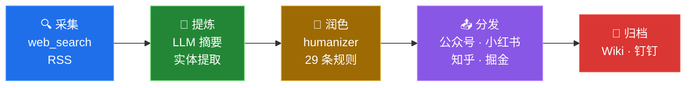

踩过的坑不少。去 AI 味是第一优先级，LLM 直接生成的文章一眼就能看出来。多平台格式差异也大，公众号要排版、小红书要图片、知乎要长文、掘金要代码示例，不能一套内容硬发。定时任务必须幂等，网络波动随时可能打断。钉钉目录必须和本地严格对齐，差一个文件夹就上传失败。

### 案例 2：个人知识库（Wiki）

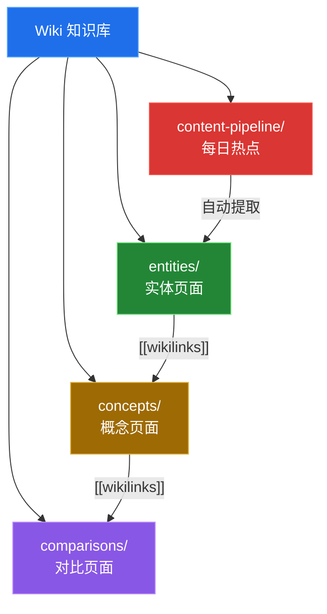

几个关键设计：每个页面有 YAML Frontmatter 元数据，页面之间用 wikilinks 互相引用，综合 3 个以上来源的页面会自动标注出处，热点新闻里的新公司新概念会自动创建页面。最大的好处是知识会复利。以前每次遇到某个问题都要重新搜一遍，现在大部分已经沉淀在 Wiki 里了。

## 使用心得

用下来最深的体会：

1. **技能系统是核心。** 解决过的问题沉淀成技能，下次直接用。技能不是文档，更像是 Agent 的肌肉记忆。
2. **上下文工程比选模型重要。** 同样用 Claude，CLAUDE.md 写得好和写得差，效果差 10 倍都不止。花时间写好项目指令，比换贵模型划算得多。
3. **定时任务是我用得最多的功能。** 大多数人把 Agent 当聊天工具，但真正省时间的是后台自动化。你不用盯着，只看结果。
4. **多平台网关解决了"在哪用"的问题。** Telegram 发指令，Mac 上执行，钉钉收通知。不用守在一个地方。
5. **记忆系统让 Agent 记住你。** 不用每次重新说你是谁、用什么技术栈、有什么偏好。

---

## 周边工具链

Hermes Agent 不是一个人在战斗。它周围还有一圈工具，各自干各自的活，组合起来才是一套完整的 AI 工作流。

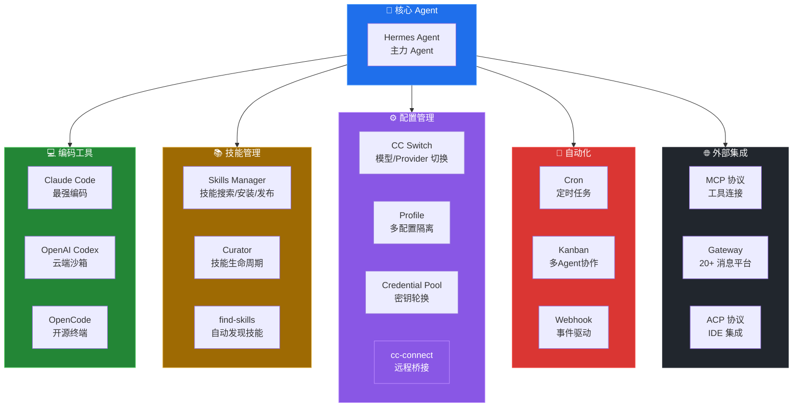

### Skills Manager（技能管理）

技能就是把解决过的问题存成 SKILL.md，下次遇到类似问题直接加载。Curator 会自动管理技能的生命周期，闲置久了会提醒你归档。find-skills 可以根据你的需求搜索和推荐新技能。

### CC Switch（模型切换）

支持 20 多个 Provider 切换，OpenRouter、Anthropic、OpenAI、DeepSeek、Google Gemini、xAI、小米 MiMo、月之暗面、阿里 DashScope 都在列。Credential Pool 可以配多个 API Key 自动轮换，单个 key 被限流了会自动切到下一个。

### cc-connect（远程桥接）

把本地 AI 编程 Agent 接入即时通讯平台的桥梁工具。支持 Claude Code、Cursor、Gemini CLI、Codex 等 7 款 Agent，可接入飞书、钉钉、Slack、Telegram、Discord、LINE、微信等主流 IM。核心场景：手机随时随地远程向工作机上的 Agent 下达指令，支持多 Agent 多平台组合。

### 其他周边工具

| 工具 | 说明 |
|------|------|
| **Profile** | 多配置隔离，不同项目用不同模型/技能/记忆 |
| **Kanban** | SQLite 任务板，多 Agent 协作，任务分发+回收 |
| **Webhook** | 事件驱动，外部系统触发 Agent 执行 |
| **Cron** | 定时任务，duration/cron/ISO 三种调度方式 |
| **MCP** | Model Context Protocol，连接任意外部工具 |
| **ACP** | Agent Client Protocol，IDE 集成标准 |
| **Gateway** | 20+ 消息平台统一接入（Telegram/Discord/Slack/钉钉/飞书/微信...） |
