> 一个写了 15 年 Java 的后端架构师，聊聊我怎么用 AI 工具干活的。
>
> 每个工具我都真的用过，每个坑我都真的踩过。不是科普，是实战记录。
>
> 

---

- [我用 AI 做了什么](#我用-ai-做了什么)
- [产品线与工程样本](#产品线与工程样本)
  - [my-agent：家庭多 Agent 协作平台](#my-agent家庭多-agent-协作平台)
  - [edu-all：教育微服务上的 AI 扩展床](#edu-all教育微服务上的-ai-扩展床)
  - [family-menu-miniapp：工程规范样本（非 AI 产品）](#family-menu-miniapp工程规范样本非-ai-产品)
  - [本仓库：工具链方法论沉淀](#本仓库工具链方法论沉淀)
- [概览：AI IDE、Vibe Coding 与 Agent](#概览ai-idevibe-coding-与-agent)
  - [AI IDE：代码编辑器的第三次进化](#ai-ide代码编辑器的第三次进化)
  - [Vibe Coding：一种新的编程方式](#vibe-coding一种新的编程方式)
  - [Agent：大模型的"手和脚"](#agent大模型的手和脚)
  - [三者的关系](#三者的关系)
- [AI IDE / 编码 Agent 对比](#ai-ide--编码-agent-对比)
  - [编码面：IDE 与 CLI Agent](#编码面ide-与-cli-agent)
  - [协作面：多 Agent 平台](#协作面多-agent-平台)
  - [常用 Skills](#常用-skills)
  - [选型建议](#选型建议)
  - [我的日常组合](#我的日常组合)
- [Vibe Coding 体验](#vibe-coding-体验)
  - [起源](#起源)
  - [我的演进](#我的演进)
  - [适用场景决策树](#适用场景决策树)
  - [Prompt 技巧](#prompt-技巧)
  - [风险](#风险)
- [Hermes Agent 深度解析](#hermes-agent-深度解析)
  - [为什么选 Hermes Agent](#为什么选-hermes-agent)
  - [核心原理](#核心原理)
  - [插件与工具生态](#插件与工具生态)
  - [我的实战案例](#我的实战案例)
    - [案例 1：内容生产管线](#案例-1内容生产管线)
    - [案例 2：个人知识库（Wiki）](#案例-2个人知识库wiki)
  - [使用心得](#使用心得)
  - [周边工具链](#周边工具链)
    - [Skills Manager（技能管理）](#skills-manager技能管理)
    - [CC Switch（模型切换）](#cc-switch模型切换)
    - [cc-connect（远程桥接）](#cc-connect远程桥接)
    - [其他周边工具](#其他周边工具)
  - [推荐](#推荐)

---

# 我用 AI 做了什么

过去一年，我把 AI 从「偶尔玩玩」变成「每天必用」：一边用 Agent 搭带生产约束的系统，一边用 Agent 把日常内容与知识沉淀跑成流水线。

下列产品仓目前多为**私有 / 暂未开源**；本页只复述可公开说的架构与方法论，不提供源码入口。

| 项目 | 可见性 | 技术 | 说明 |
| ------ | ------ | ------ | ------ |
| **my-agent** | 私有 · 暂未开源 | Java 25 · Spring Boot 4.1 · AgentScope 2.0.3 | 家庭多 Agent 平台：Planner + 8 SubAgent；双 RAG；Mem0 增强召回；REST / A2A / Agent Protocol / ACP-stdio（CLI） |
| **edu-all** | 私有 · 未开源实验床 | Java 25 · Spring Boot 4.2-M1 · Spring Cloud 2025.1 | 在线教育微服务全栈；`edu-llm` 扩展挂 AgentScope 2.0.0 + MCP client/server |
| **family-menu-miniapp** | 私有 · 暂未开源 | 微信云开发 · TDesign | 「她的菜单本」家庭点单；业务侧不做 LLM，用 AGENTS/CONTEXT/Issues 让 Agent 可维护 |
| **热点内容生产** | 工作流 | Hermes Agent + Cron | 每日热点采集 → 提炼 → 去 AI 味 → 多平台分发 → Wiki / IM 归档 |
| **个人知识库** | 本地 Wiki（不在本仓） | Hermes Agent + LLMWiki | 实体 / 概念 / 对比三类页面，wikilinks 交叉引用，热点自动沉淀 |
| **macOS / 浏览器自动化** | 本地脚本 | Playwright · AppleScript · CLI | 搜索记录、Chrome 控制、备忘录 / 消息等本地自动化 |

本仓库（[my-ai-stack](https://github.com/leohou0430/my-ai-stack)）本身是**公开的工具链与方法论笔记**，不聚合上述产品源码；产品仓各自独立演进。

---

# 产品线与工程样本

下面几条是我最近真正花时间打磨的产品或工程样本，也是「AI 辅助写代码」之外，更接近「用 AI 把架构约束落地」的部分。

## my-agent：家庭多 Agent 协作平台

这是当前最接近「完整 Agent 产品」的项目。目标不是 Demo Chat，而是一个带家庭隔离、治理配额、多协议接入和可观测性的协作服务。架构图如下：
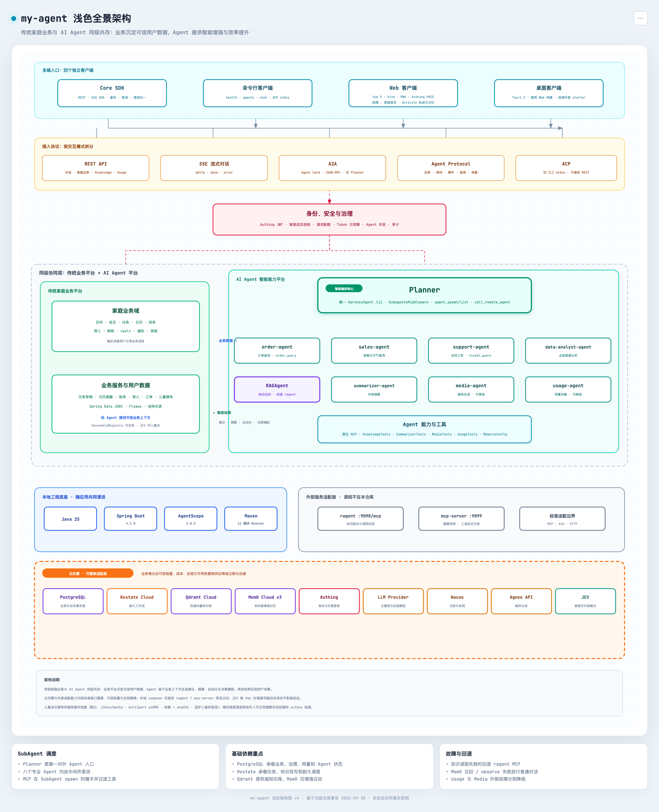

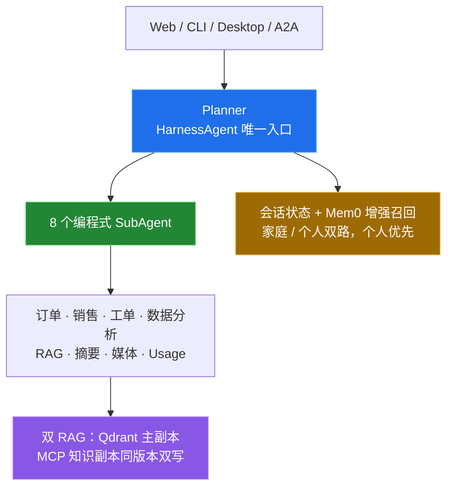

**可公开复述的架构摘要：**

- 栈：Java 25、Spring Boot 4.1、agentscope-java 2.0.3；Maven 多模块 reactor + 独立 npm 客户端（core / cli / web / desktop）
- 拓扑：Planner 经 SubagentsMiddleware 调度 8 个 SubAgent；对外只暴露 Planner
- 协议：REST chat/stream、A2A Agent Card、Agent Protocol（durable `/tasks`）、CLI ACP-stdio
- 知识：主检索走 AgentScope SimpleKnowledge + Qdrant；回退 MCP 知识副本；写入经工作流保证同版本同步
- 记忆：Mem0 Cloud v3 做非权威增强召回；普通对话只自动沉淀个人范围，家庭共享必须用户明确要求
- 家庭域：任务草稿、日历、财务、育儿媒体、购物与家庭记忆等；敏感写路径可走外部裁决
- 身份与治理：JWT `sub` 派生个人主体 + 必填家庭成员校验；分钟限流 / 并发隔离 / 日配额（含模型 token 预算）
- 客户端：Vue 3 + Vite Web；Desktop 基于 Tauri 2

对我来说，这个项目验证的不是「Agent 能不能聊天」，而是：**多协议、多租户家庭边界、双副本检索、增强记忆和治理能不能同时站住。**

## edu-all：教育微服务上的 AI 扩展床

edu-all 是一套完整的在线教育 Spring Cloud 微服务（网关、认证授权、用户、课程、订单、支付、评论、消息、前后端 BFF 等），长期用来跟前沿 Java / Cloud 栈。源码目前**未开源**。

近期和 AI 相关的进展集中在扩展模块 `edu-llm`（尚未成为核心交易主路径）：

- `edu-ai-boot`：AgentScope harness 接入（钉在 **2.0.0**）
- `edu-mcp-client` / `edu-mcp-server`：把 MCP 当作服务间工具边界来试
- 依赖面同时覆盖 Spring AI、LangChain4j 等，方便横向对比，而不是押单一框架
- 宿主平台本身：Java 25、Spring Boot 4.2-M1、Spring Cloud 2025.1、Nacos / Apollo / RocketMQ / 虚拟线程 / OTel；课程服务还做过 GraalVM Native Image

策略很明确：**先把微服务底座顶到较新的版本，再在扩展层挂 Agent / MCP，避免把实验能力焊死进核心交易路径。**

## family-menu-miniapp：工程规范样本（非 AI 产品）

「她的菜单本」是微信云开发家庭协作点单小程序：厨房菜单本、本地草稿单、云端订单状态机、邀请码建家、订阅消息通知。源码目前**暂未开源**。

业务本身几乎不用 LLM。它出现在这份笔记里，是因为我把它当成「**非 AI 产品，如何用 Agent 友好工程规范维护**」的样本：

- 根目录 `CONTEXT.md` 管领域术语，`AGENTS.md` 管实现事实
- ADR + GitHub Issues 驱动需求；标签区分 `needs-triage` / `ready-for-agent` / `ready-for-human` 等角色
- 云函数契约统一 `{ action, data }`；封面 / 头像用组件级降级，而不是堆默认图
- 自动化测试覆盖云函数纯逻辑与自定义组件

结论：Agent 编码协作的上限，往往不取决于模型，而取决于**领域边界和文档是否写清楚**。

## 本仓库：工具链方法论沉淀

`my-ai-stack` 不放产品代码，只记录我怎么选 IDE、怎么划 Vibe Coding 边界、怎么把 Hermes / Skills / MCP / 远程桥接拼成日常工作流。下面两大部分（IDE / 多 Agent 协作 / Skills，以及 Hermes）仍然是这份笔记的主体。

---

# 概览：AI IDE、Vibe Coding 与 Agent

## AI IDE：代码编辑器的第三次进化

2021 年 Copilot 问世，2023 年 Cursor 出来，代码编辑器开始不一样了。以前是纯文本工具，现在能理解你的项目、帮你写代码、甚至帮你重构。这是大模型能力最早落地的场景。

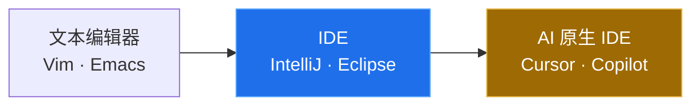

| 工具 | 形态 | 我的用法 |
| ----- | ------ | ---------- |
| **Cursor** | AI 原生 IDE | 跨仓原型、Agent 改仓 |
| **Codex** | OpenAI 编码 Agent（CLI / IDE / Cloud） | 长任务、沙箱结对 |
| **Qoder** | Agentic Coding 平台（IDE + Quest） | Spec / 异步委派 |
| **ZCode** | Z.ai ADE，深度适配 GLM | 长上下文 GLM 编码 |
| **OpenCode** | 开源终端 / 桌面 Agent | BYOK、PR Review |
| **CC GUI** | Claude Code / Codex 等 CLI 的图形壳 | 不想泡终端时管多会话 |
| **JetBrains AI** | IntelliJ 生态 | Java 调试与重构 |

## Vibe Coding：一种新的编程方式

2025 年 Karpathy 发了条推文，说有一种新的编程方式叫 vibe coding，"忘掉代码本身，拥抱感觉"。说白了就是用自然语言告诉 AI 你想要什么，它来写代码。这其实是 AI IDE 的下一步：不只是辅助你写代码，而是让写代码这件事本身变得可选。

听起来挺好，但我自己的感受是：写个脚本、做个原型，确实快。但放到带生产约束的后端上，我还是不放心。我的做法是用它加速，但最终靠自己的经验把关——尤其是身份隔离、配额、双写一致性和协议边界这类地方。

## Agent：大模型的"手和脚"

Vibe Coding 是让 AI 帮你写代码，Agent 是让 AI 帮你干活。2025 年开始，Agent 从编程场景扩展到通用任务：规划任务、调用工具、操作浏览器、管理文件，自己把一整套流程跑完。

```mermaid
graph TB
    subgraph Agent["AI Agent"]
        LLM["大脑 LLM"]
        MEM["记忆系统"]
        PLAN["规划引擎"]
        LLM <--> MEM
        LLM <--> PLAN
    end
    subgraph Tools["工具集"]
        T1["文件"] --- T2["终端"] --- T3["浏览器"] --- T4["API"]
    end
    subgraph Exec["执行"]
        E1["本地终端"] --- E2["云端沙箱"] --- E3["浏览器"]
    end
    LLM --> Tools --> Exec -->|"观察结果"| LLM
    style Agent fill:#161b22,stroke:#30363d
    style Tools fill:#161b22,stroke:#30363d
    style Exec fill:#161b22,stroke:#30363d
```

这里面有几个绕不开的概念。ReAct 模式是所有 Agent 的基础，就是"想一想、做一做、看看结果、再想一想"这个循环。MCP 协议解决了工具连接的标准化问题，类似于 USB 之于硬件。上下文工程决定了 Agent 能看到什么信息，这一条往往比选哪个模型更影响效果。

## 三者的关系

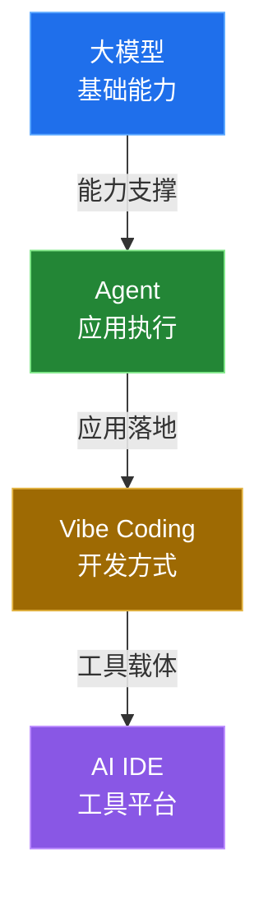

打个比方：大模型是引擎，Agent 是汽车，Vibe Coding 是驾驶方式，AI IDE 是驾驶舱。

---

# AI IDE / 编码 Agent 对比

编码工具已经不只是「一个编辑器 + 补全」。我自己把它拆成三层：**谁写代码**（IDE / CLI Agent）、**谁编排多人多 Agent**（协作平台）、**怎么把流程沉淀成可复用技能**（Skills）。

## 编码面：IDE 与 CLI Agent

| 工具 | 基础 | 核心优势 | 主要缺点 | 价格 / 许可 |
| ----- | ------ | ---------- | ---------- | ------ |
| **Cursor** | VS Code Fork | Agent 模式强，多根工作区协作顺 | 信用额度制，费用敏感 | $20-200/月 |
| **Codex** | OpenAI 编码 Agent | CLI / IDE 插件 / Cloud 一体；长任务与沙箱 | 生态绑 OpenAI / ChatGPT 套餐 | 套餐或 API |
| **Qoder** | Agentic Coding 平台 | IDE 结对 + Quest 异步委派；偏 Spec 全流程 | 商业闭源，生态较新 | 免费档 + 付费 |
| **ZCode** | Z.ai ADE | 以 Agent 对话为中心；深度适配 GLM 长上下文 | 模型侧偏 GLM / Z.ai 生态 | 桌面免费，模型按套餐/Key |
| **OpenCode** | 开源终端 / 桌面 Agent | 多 Provider、BYOK、轻量灵活 | 单产品深度不如 Cursor | 开源（可选付费通道） |
| **CC GUI** | CLI Agent 图形壳 | 给 Claude Code / Codex 等加桌面会话管理 | 名称撞车多，属社区壳非官方 | 开源社区项目 |
| **VS Code + Copilot** | VS Code 原生 | 生态最大，价格稳 | Agent 深度通常弱于专用 Agent IDE | $0-39/月 |
| **JetBrains AI** | IntelliJ 平台 | Java 重构 / Debug 仍是主场 | AI 能力相对后发 | 捆绑订阅 |

要点：

- **Codex** 这里指 OpenAI 现行编码 Agent（`openai/codex` CLI 等），不是 2021 年那个旧补全模型。
- **CC GUI** 是「给终端 Agent 套壳」，不是又一个模型；我用它管多引擎会话，真正干活的还是底下的 Claude Code / Codex。
- **ZCode** 和 Cursor 路线不同：编辑器不是主角，Agent 任务流才是。

## 协作面：多 Agent 平台

单 Agent 写代码够用一阵子；真正费神的是「多人 + 多 Agent + 多任务」怎么派活、怎么隔离、怎么验收。下面几款是我跟过的协作层（注意：**Orca ADE ≠ OrcaRouter**）。

| 平台 | 一句话定位 | 典型打法 | 备注 |
| ------ | ---------- | ---------- | ------ |
| **Multica** | 开源人机共仓：把 Coding Agent 当工作区队友 | Issue 指派给 Agent；Squad 队长路由；本机 daemon 跑 Claude Code / Codex / Cursor 等 | 可自托管；偏「工单委派」 |
| **Orca（ADE）** | 并行 Agent 开发环境：多 CLI + git worktree 隔离 | 同一提示扇出多个 Agent，比 diff 选赢家；本机编排，不拦流量 | MIT 开源桌面 ADE（onorca.dev）；**不是**模型网关 |
| **Loop** | 平凯星辰的人机协作空间：Agent 当「同事」 | 频道 / 话题 / `@` 显式唤醒；Soul / Agent / Instance 角色可带走 | 偏「同事共处」；与 Multica 常被对比 |
| **HiFox** | 多人多 Agent 看板指挥层 | 任务派给 Agent，worktree 并行；接 Claude Code / Codex / OpenCode / Hermes 等 CLI | 产品层免费，Token 走你已有 Agent；勿与 hifox.ai 内容站混淆 |

怎么选（我自己的粗分）：

- 要**开源自托管 + Issue 生命周期**：先看 Multica。
- 要**本机并行多 CLI、比方案**：先看 Orca ADE。
- 要**频道式长期共处、角色资产可迁移**：先看 Loop。
- 要**看板指派 + 团队上下文收件箱**：先看 HiFox。

它们大多**不替代** Cursor / Codex，而是站在执行层上面做派工与编排。

## 常用 Skills

Skills 是把「已经跑通的流程」写成 `SKILL.md`，下次直接加载。我高频用的几套：

| Skill / 套件 | 一句话 | 我怎么用 |
| ------ | ------ | ------ |
| **Superpowers** | 可组合交付工作流（头脑风暴 → 计划 → TDD → 调试 → 评审） | 复杂功能开工前先走流程技能，少跳步 |
| **grill-me / grilling** | 逼问式对齐：逐枝追问计划与设计，直到共同理解 | 架构决策、大重构前先 grill，逼自己把边界说清 |
| **OpenSpec** | 轻量 Spec-Driven Development：先对齐规格再写码 | `propose → apply → archive`；适合需求易漂的改动 |

另外还有项目内自建技能（重启调试器、浏览器验收、领域词表同步等）：原则是——**解决过一次的流程，就不要第二次全靠聊天临场发挥**。

## 选型建议

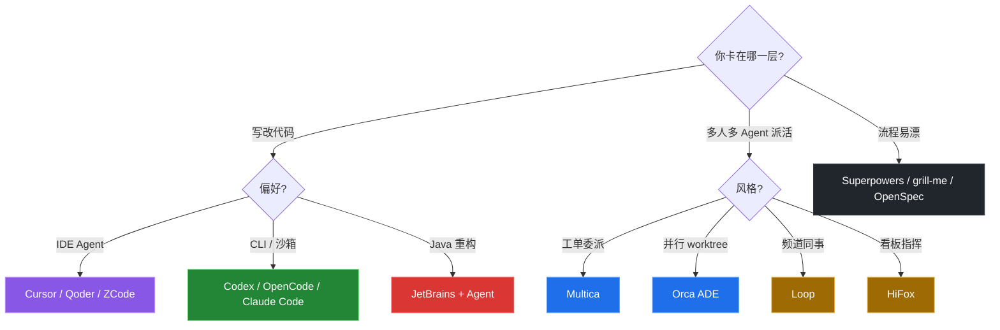

## 我的日常组合

| 场景 | 工具 | 原因 |
| ------ | ------ | ------ |
| Java Agent / 微服务主工程 | IntelliJ Debug + Cursor / Codex / Qoder / OpenCode | 调试仍靠 JetBrains；大块实现交给编码 Agent |
| GLM 长任务 / ADE 体验 | ZCode | Agent 中心布局 + GLM 长上下文 |
| CLI 会话不想泡终端 | CC GUI | 给 Claude Code / Codex 套图形壳 |
| 跨仓原型与文档 | Cursor | Agent 模式、多根工作区最顺 |
| 并行比方案 / worktree | Orca ADE | 多 CLI 同仓扇出，比 diff |
| 人机看板派活 | Multica / Loop / HiFox | 按「工单 / 同事 / 指挥台」选壳 |
| 需求对齐与规格 | grill-me · OpenSpec · Superpowers | 先对齐再动手，少返工 |
| 终端自动化 / 内容生产 | Hermes Agent | 多平台网关 + Skills + Cron |
| 手机远程指挥本机 Agent | cc-connect | 把本地编码 Agent 接到 IM |
| 多模型路由 | OrcaRouter | 网关层选模；**勿与 Orca ADE 混淆** |

---

# Vibe Coding 体验

> 从手写每一行到"说人话写代码"，一个 15 年老兵的真实感受

## 起源

2025 年 Karpathy：

> *"There's a new kind of coding I call 'vibe coding', where you fully give in to the vibes, embrace exponentials, and forget that the code even exists."*

## 我的演进

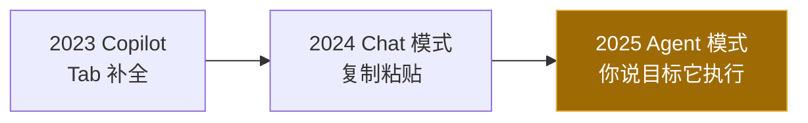

从 Copilot 的 Tab 补全（说实话对我这种老手帮助有限），到 Chat 模式（每次都要复制粘贴，上下文断裂），再到 Agent 模式（你说目标它自己去改文件、跑测试）。每一步都是质的飞跃。

## 适用场景决策树

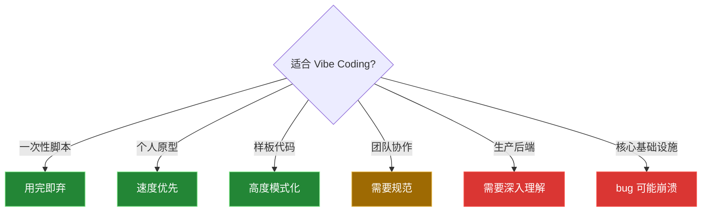

对我自己：样板、测试脚手架、文档同步可以大胆 Vibe；身份、配额、双写、协议兼容必须自己读完再合。

## Prompt 技巧

Vibe Coding 的效果，80% 取决于你的 Prompt 质量：

| 技巧 | 说明 |
| ------ | ------ |
| 说清楚技术栈 | 不要让 AI 自己选，它可能选一个你不熟的 |
| 描述行为而非实现 | "用户登录后跳转首页" 比 "用 redirect" 好 |
| 给出约束条件 | "不要用 class 组件"、"用 Java 25 record" |
| 分步骤描述 | 复杂需求拆成小步骤，每步给 Agent 执行 |
| 提供上下文 | "参考 UserService 的写法" 比从零开始好 |
| 先写领域词表 | `CONTEXT.md` / `AGENTS.md` 写清楚后，Agent 少发明术语 |

## 风险

几个实际风险。技术债：你不理解代码就没法优化和重构，跑得快但债务在涨。安全漏洞：AI 会生成有 SQL 注入、XSS 问题的代码，它不替你把安全关。调试困难：出了 bug 你不懂逻辑，排查起来很痛苦。能力退化：长期依赖 AI，手写代码的感觉会变钝。多租户与密钥：Agent 很爱把本地配置、真实 Key、个人路径写进文档——公开仓库必须单独过一遍脱敏。

---

# Hermes Agent 深度解析

Claude Code、Cursor Agent 我都用过，最后选了 Hermes Agent 当**日常自动化主力**。编码主战场仍在 Cursor / JetBrains；Hermes 更擅长「跨消息平台网关 + 定时任务 + 可复用技能」。

## 为什么选 Hermes Agent

```mermaid
graph LR
    subgraph Hermes["Hermes Agent"]
        H1["开源"] --- H2["多平台网关"] --- H3["技能系统"] --- H4["持久记忆"] --- H5["20+ 模型"] --- H6["定时任务"]
    end
    subgraph Others["其他 Agent"]
        O1["Claude Code<br>终端为主"] --- O2["Codex CLI<br>终端为主"] --- O3["Cursor Agent<br>以 IDE 为主"]
    end
    style Hermes fill:#238636,stroke:#7ee787,color:#fff
    style Others fill:#21262d,stroke:#30363d
```

| 特性 | Hermes Agent | Claude Code | Codex CLI |
| ------ | :---: | :---: | :---: |
| 开源 | ✅ | ❌ | ✅ |
| 多平台网关 | ✅ (Telegram/Discord/Slack/钉钉...) | ❌ | ❌ |
| 技能系统 | ✅ (跨 IM + Cron 可复用) | ✅ (终端/IDE Skills) | 有限 |
| 持久记忆 | ✅ (跨 session) | 有限 | ❌ |
| 多模型切换 | ✅ (20+ provider) | 仅 Claude | 仅 OpenAI |
| 定时任务 | ✅ (cron) | ❌ | ❌ |

Hermes 的差异不在「有没有技能文件」，而在**网关 + Cron + 技能**能拼成可无人值守的日常流水线。

## 核心原理

**关键机制：**

- **工具调用（Tool Use）**：LLM 通过 JSON Schema 定义的工具接口与外部世界交互
- **上下文压缩**：对话接近 token 上限时自动压缩历史，保留关键信息
- **技能加载**：SKILL.md 注入 System Prompt，Agent 严格按步骤执行
- **子任务委派**：`delegate_task` 可以并行生成多个子 Agent 处理不同任务
- **MCP 协议**：通过 Model Context Protocol 连接任意外部工具

## 插件与工具生态

Hermes Agent 厉害的地方不是自带多少功能，而是你能往上面加东西。插件、工具、技能、消息平台，按需拼。

```mermaid
graph TB
    subgraph Platforms["消息平台"]
        P1["Telegram"] --- P2["Discord"] --- P3["Slack"] --- P4["钉钉"] --- P5["飞书"] --- P6["微信"]
    end
    subgraph Tools["工具集"]
        T1["web"] --- T2["terminal"] --- T3["file"] --- T4["browser"] --- T5["vision"]
        T6["tts"] --- T7["image_gen"] --- T8["video"] --- T9["spotify"] --- T10["homeassistant"]
    end
    subgraph Plugins["插件"]
        PL1["security-guidance"] --- PL2["browser-use"] --- PL3["firecrawl"]
        PL4["fal · xai"] --- PL5["google_meet"] --- PL6["tavily"]
    end
    subgraph Skills["技能"]
        SK1["content-pipeline"] --- SK2["auto-chat"] --- SK3["xurl"]
        SK4["humanizer"] --- SK5["claude-code"] --- SK6["blogwatcher"]
    end
    Platforms --- Tools --- Plugins --- Skills
    style Platforms fill:#161b22,stroke:#30363d
    style Tools fill:#161b22,stroke:#30363d
    style Plugins fill:#161b22,stroke:#30363d
    style Skills fill:#161b22,stroke:#30363d
```

## 我的实战案例

### 案例 1：内容生产管线

这是我搭的最复杂的一条自动化流水线，每天定时跑，从热点采集到多平台分发全自动：

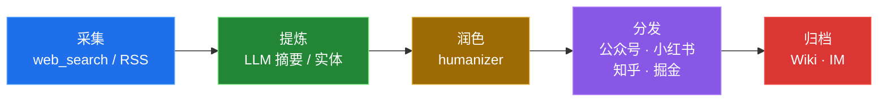

踩过的坑不少。去 AI 味是第一优先级，LLM 直接生成的文章一眼就能看出来。多平台格式差异也大，公众号要排版、小红书要图片、知乎要长文、掘金要代码示例，不能一套内容硬发。定时任务必须幂等，网络波动随时可能打断。归档目录也必须和本地结构严格对齐，差一层就会失败。

### 案例 2：个人知识库（Wiki）

这套 Wiki 跑在**本机知识库**里，不在 `my-ai-stack` 仓库中。

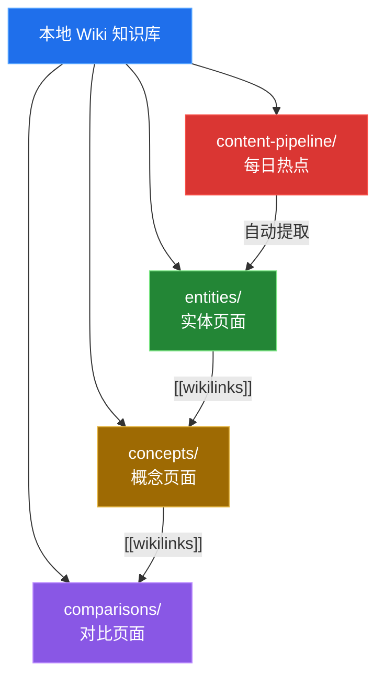

几个关键设计：每个页面有 YAML Frontmatter 元数据，页面之间用 wikilinks 互相引用，综合多个来源的页面会标注出处，热点里的新公司新概念会自动建页。最大的好处是知识会复利——以前每次遇到问题都要重新搜，现在大半已经沉淀在 Wiki 里。

## 使用心得

用下来最深的体会：

1. **技能系统是核心。** 解决过的问题沉淀成技能，下次直接用。技能不是文档，更像是 Agent 的肌肉记忆。
2. **上下文工程比选模型重要。** 同样用 Claude，项目指令写得好和写得差，效果差一个数量级。花时间写好 `AGENTS.md` / `CONTEXT.md`，比换贵模型划算。
3. **定时任务是我用得最多的功能。** 大多数人把 Agent 当聊天工具，但真正省时间的是后台自动化。你不用盯着，只看结果。
4. **多平台网关解决了"在哪用"的问题。** IM 发指令，本机执行，另一个 IM 收通知。不用守在一个地方。
5. **记忆系统让 Agent 记住你。** 不用每次重新说你是谁、用什么技术栈、有什么偏好。
6. **造系统和用系统是两条线。** 写 my-agent / edu-all 时我更信 IDE Agent；跑内容管线时我更信 Hermes。不要用一把锤子敲所有钉子。

---

## 周边工具链

Hermes Agent 不是一个人在战斗。它周围还有一圈工具，各自干各自的活，组合起来才是一套完整的 AI 工作流。

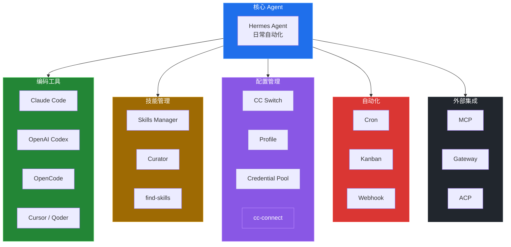

### Skills Manager（技能管理）

技能就是把解决过的问题存成 SKILL.md，下次遇到类似问题直接加载。Curator 会自动管理技能的生命周期，闲置久了会提醒你归档。find-skills 可以根据你的需求搜索和推荐新技能。

编码侧我还会叠三套「流程型」技能（详见上文 [常用 Skills](#常用-skills)）：**Superpowers** 管交付节奏，**grill-me** 管决策对齐，**OpenSpec** 管规格落仓——和 Hermes 的内容生产技能不是同一层，但都是「别让 Agent 每次从零猜流程」。

### CC Switch（模型切换）

支持 20 多个 Provider 切换，OpenRouter、Anthropic、OpenAI、DeepSeek、Google Gemini、xAI、小米 MiMo、月之暗面、阿里 DashScope 都在列。Credential Pool 可以配多个 API Key 自动轮换，单个 key 被限流了会自动切到下一个。

### cc-connect（远程桥接）

把本地 AI 编程 Agent 接入即时通讯平台的桥梁工具。支持 Claude Code、Cursor、Gemini CLI、Codex 等主流 Agent，可接入飞书、钉钉、Slack、Telegram、Discord、LINE、微信等 IM。核心场景：手机随时随地远程向工作机上的 Agent 下达指令，支持多 Agent 多平台组合。

### 其他周边工具

| 工具 | 说明 |
| ------ | ------ |
| **Profile** | 多配置隔离，不同项目用不同模型/技能/记忆 |
| **Kanban** | SQLite 任务板，多 Agent 协作，任务分发+回收 |
| **Webhook** | 事件驱动，外部系统触发 Agent 执行 |
| **Cron** | 定时任务，duration/cron/ISO 三种调度方式 |
| **MCP** | Model Context Protocol，连接任意外部工具 |
| **ACP** | Agent Client Protocol，IDE 集成标准 |
| **Gateway** | 20+ 消息平台统一接入（Telegram/Discord/Slack/钉钉/飞书/微信...） |

---

## 推荐

- **OrcaRouter**：多模型路由 / 治理网关（改 `base_url` 即可喂给 Claude Code、Codex、OpenCode 等）。
- **Orca ADE**：并行多 Agent 的桌面编排环境（worktree 隔离）。两者名字相近，职责完全不同。

